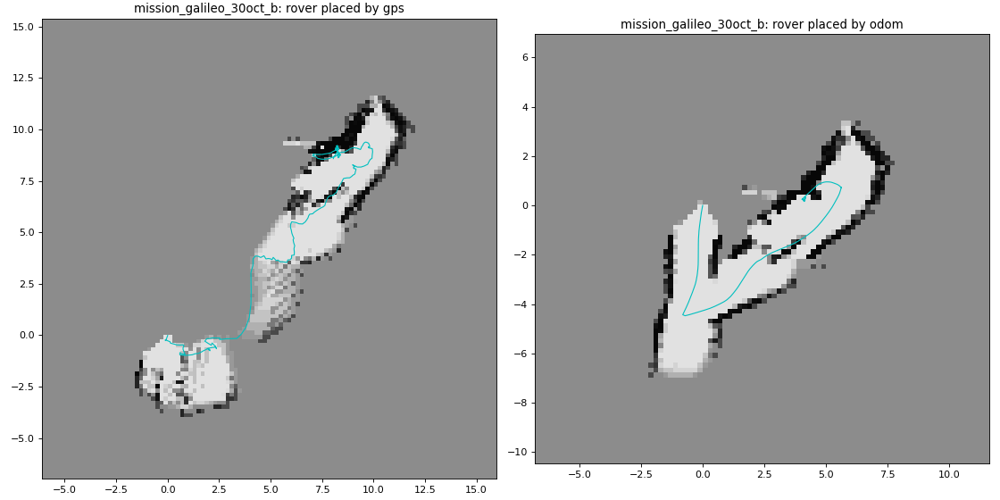
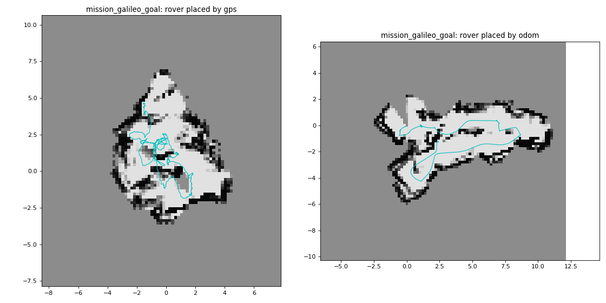

# Mapa local en el marco de la odometría (`local_map_pose:=odom`)

30-oct-2026 · `checkpoint_controller_node` (misiones con GPS) · `local_planner.OdomPose`

## Resumen

En las misiones con GPS, el mapa local (perfiles de UniDepthV2 → `/erc/free_space` → `LocalCostmap`) ubicaba cada
perfil en la posición de `/erc/gps/filtered`. Ese GPS se mueve metros aunque el robot esté quieto, así que los muros
quedaban pintados varias veces, corridos entre sí, y en un pasillo de 2 m el mapa lo cerraba: "route blocked" durante
minutos en una rampa que el robot había subido el día anterior.

Con `local_map_pose:=odom`, la posición del robot en el mapa sale de la **odometría** (`/erc/odometry/local`) y del
rumbo de `heading_node`. El **GPS solo dice dónde queda el checkpoint**, con una corrección lenta. Es lo que ya hacía
el mapa de las misiones indoor.

| Prueba | Mapa con GPS (antes) | Mapa con odometría |
|---|---|---|
| Bag `mission_galileo_30oct_b` (rampa): recorrido que el mapa pone dentro de un muro | 14.3 % | **1.9 %** |
| Bag `mission_galileo_goal` (plaza de maceteros): lo mismo | 1.4 % | 0.7 % |
| Simulador, rutas desconocidas, GPS bueno (0.2 m), 40 corridas | 40/40 · 204 s | 39/40 · **156 s** |
| Simulador, rutas desconocidas, GPS errante (1.5 m, 20 s), 16 corridas | **7/16** · en movimiento 10 % | **16/16** · en movimiento 85 % |
| Simulador, escenarios estándar, GPS errante, 36 corridas | 31/36 | **36/36** |
| ROS de punta a punta (`fake_world` walkway, GPS errante) | no llegó en 480 s (21 vueltas) | **llegó en 363 s** |

Por defecto el nodo sigue con el GPS (`local_map_pose:=gps`): el modo nuevo hay que pedirlo.

## El problema, medido

En el bag `mission_galileo_30oct_b` (30-oct, Universidad Galileo):

- **Con las ruedas quietas:** la pose del mapa se movió 8.6 m en 78 s.
- **Recorrido total:** la pose suma 31.3 m; las ruedas, 15.9 m. La mitad del recorrido es ruido del GPS.
- **La odometría** (`/erc/odometry/local`, 30 Hz) recorre 16.9 m, cerca de las ruedas, y se mueve 1.1 m con las ruedas
  quietas (las transiciones del EKF al detenerse).

Además, ese día el GPS tenía un sesgo distinto en cada lugar: respecto del día anterior, 15 m en A, 11 m en B y 1 m en C.

## Cómo funciona

`local_planner.OdomPose` (sin ROS; la usan el nodo, `controller_sim` y `map_pose_replay.py`):

1. **Posición:** cada mensaje de odometría aporta su avance con signo, medido en su propio rumbo (`ds = Δp · [cos ψ, sin ψ]`).
   Ese avance se suma en la dirección del rumbo ENU que usa el mapa (`/erc/heading_deg`). Así el mapa, la pose y los
   perfiles usan el mismo rumbo, aunque el rumbo propio de la odometría se haya desviado. Un salto de más de 1 m entre
   dos mensajes se toma como reinicio de la odometría, no como avance.
2. **Corrección del GPS:** `corr` es un filtro de primer orden (constante `odom_pose.gps_tau_s`, 20 s) de *GPS − posición*.
   Absorbe la deriva de la odometría y el sesgo lento del GPS.
3. **Uso de la corrección:** el checkpoint y la ruta inicial se llevan al mapa restando `corr`. Si el checkpoint visto
   por el GPS se mueve más de 0.5 m, se mueve el final de la ruta. **Lo que ya está en el mapa nunca se mueve.**

En `checkpoint_controller_node`:

- **Un marco por misión:** todos los tramos usan el marco del primero, así que `keep_map` pasa el mapa de un tramo al
  siguiente tal cual.
- **Llegada:** se sigue midiendo con el GPS, igual que la mide el servidor de misiones.
- **Carrot:** `carrot_controller_node` ubica `/goal_gps` contra el GPS. Por eso el carrot se publica como *GPS actual +
  (carrot − pose en el mapa)*: le llega el vector correcto desde el robot.
- **OSM:** la capa estática de edificios se consulta desplazada por `corr`.
- **TF:** se publica `odom → leg_local` (parámetro `leg_tf_parent`, por defecto `odom`). Con eso `/erc/local_costmap`,
  `/erc/local_route` y `/erc/carrot` se ven en Foxglove con cualquier marco (`map`, `odom`, `base_link`), no solo con
  `rover_leg`. Esto vale también en modo `gps`.

## Parámetros nuevos (`checkpoint_controller_node`)

| Parámetro | Por defecto | Qué hace |
|---|---|---|
| `local_map_pose` | `gps` | `odom`: el mapa local usa la odometría. Solo tiene efecto con `local_replan:=true`. |
| `odom_topic` | `/erc/odometry/local` | La odometría (wheels + gyro de `erc_localization`). |
| `odom_pose.gps_tau_s` | `20.0` | Lentitud con que el GPS mueve el checkpoint. En las reproducciones, 10–40 s dan lo mismo. |
| `leg_tf_parent` | `odom` | Padre de `leg_local` en TF; `''` lo deja como árbol aparte, como antes. |

## Uso en campo

T5, con `-p local_map_pose:=odom` agregado:

```bash
source /opt/ros/jazzy/setup.bash && source ~/lsdc_ws/install/setup.bash
ros2 run erc_controller checkpoint_controller_node --ros-args \
  -p checkpoint_list_url:=http://localhost:8001/checkpoints-list \
  -p checkpoint_reached_url:=http://localhost:8001/checkpoint-reached \
  -p checkpoint_proximity_m:=4.0 -p carrot_distance_m:=1.5 \
  -p local_replan:=true -p local.goal_mode:=true -p local.keep_map:=true \
  -p local.rejoin_respects_unseen:=true -p local.unseen_extend_m:=0.1 \
  -p recovery.explore:=true -p local_map_pose:=odom
```

Al empezar el tramo, el log dice
`... rover pose from odometry (GPS - odometry so far: x, y m)`. Esos dos números son la corrección acumulada: si
crecen muchos metros en un tramo corto, el rumbo o el GPS están mal.

## Figuras

El mismo bag, con los mismos perfiles de UniDepth y la pose de cada modo (izquierda GPS, derecha odometría).
En gris, lo no visto; en negro, lo ocupado; en celeste, el recorrido según el mapa.





## Lo que no resuelve (abierto)

- **Una corrida del simulador falla en modo odometría** con GPS bueno: `walkway`, semilla 1 (la misma en todas las
  tandas). El robot queda arrinconado al fondo cerrado del pasillo, y la recuperación gira hacia la esquina una y otra
  vez. Parece un punto débil del modo meta en callejones sin salida más que de la pose, pero no está demostrado.
- **Cercanía a obstáculos:** en ambos modos, el 46–62 % del recorrido queda a menos de `inflate_m` (0.45 m) de algo
  ocupado según el propio mapa. O el perfil de UniDepth ve los muros más cerca de lo que están, o 0.45 m es mucho para
  un pasillo de 2 m. No se ha medido contra cinta.
- **El rumbo sigue mandando:** si `heading_node` ancla mal, el mapa sale coherente pero girado, y el robot apunta al
  checkpoint con ese error, igual que en modo GPS. Un re-anclaje del rumbo limpia el mapa del tramo, como antes.
- **El simulador no tiene retraso de odometría:** la odometría del SDK llega con el mismo retraso que el resto de la
  telemetría (~1–1.3 s). En el campo, la pose y el perfil pueden desfasarse en los giros.

## Cómo reproducir

```bash
# 1. Reconstruir el mapa de un bag con las dos poses
source /opt/ros/jazzy/setup.bash
python3 rover_simulation/map_pose_replay.py ~/lsdc/erc-omni-vla/rosbags/mission_galileo_30oct_b --out mapa.png

# 2. Simulador: rutas desconocidas (o escenarios estándar sin --scenarios), GPS errante
source ~/lsdc_ws/install/setup.bash
cd rover_simulation
~/lsdc/erc-omni-vla/.venv/bin/python3 reactive_check.py --seeds 4 --plants mini \
  --scenarios walkway,walkway_back,wall_long,dead_end \
  --configs reactive+goal,reactive+goal+odom --gps-sigma 1.5 --gps-tau 20 --fails

# 3. ROS de punta a punta (fake_world: GPS_WANDER_M, GPS_WANDER_TAU_S, ODOM_SCALE)
cd e2e
START_YAW_DEG=90 GPS_WANDER_M=1.5 GPS_WANDER_TAU_S=20 CARROT_EXTRA="-p drive_mode:=reactive" TAG=odom \
CP_EXTRA="-p checkpoint_proximity_m:=4.0 -p local.goal_mode:=true -p local.keep_map:=true \
  -p local.rejoin_respects_unseen:=true -p local.unseen_extend_m:=0.1 -p recovery.explore:=true \
  -p local_map_pose:=odom" ./run_e2e.sh walkway 480 true 1.5

# 4. Pruebas unitarias
cd ../../erc_controller && python3 -m pytest -q test/test_odom_pose.py
```

## Después de la primera corrida en campo (30-oct, `mission_galileo_30oct_odom`)

**Lo que pasó:**
- **A y B:** se alcanzaron y el servidor los confirmó (`latest_scanned_checkpoint: 2`). El nodo no lo decía de forma
  visible.
- **El mapa en odometría:** funcionó. El pasillo de la rampa quedó limpio y la corrección GPS − odometría fue de
  4 m en B.
- **B → C:** el paso real está **arriba de la rampa, a la izquierda, junto a un árbol**. Arriba, C quedaba ~80° a
  la izquierda, y el mapa (±40° al frente: `map_fov_deg` es el ángulo a cada lado) nunca miró hacia allá. Lo que vio de lado al acercarse (fin del muro,
  planter) cerró esa esquina. A* tomó un desvío de 33 m para 14 m en línea recta: rampa abajo y por fuera. Terminó
  con la cámara contra el muro, girando en el sitio durante 100 s.
- **Holgura:** reducir `local.inflate_m` (0.45 → 0.30) no reabre la esquina una vez vista de cerca. Comprobado
  reconstruyendo el mapa desde el bag.

**Cambios:**

| Cambio | Parámetro | Por defecto | Simulador (rutas desconocidas, GPS bueno, 30 corridas) |
|---|---|---|---|
| Aviso `Checkpoint N CONFIRMED by the SDK (k/n)` en el log | — | siempre | — |
| Mirar hacia el checkpoint antes de un desvío largo: si la ruta nueva mide ≥ 1.5× la recta y ≥ 5 m más, y el checkpoint está a > 30° del rumbo, frena, gira hacia él, espera y replanifica (`local_recovery.BlockedRecovery.detour_look`) | `recovery.detour_look` | `false` | 29/30 → **30/30** (resuelve el arrinconamiento de `walkway` semilla 1); 143 → 177 s |
| Retroceder ~0.45 m si hay algo a < 0.35 m al frente durante 4 s sin avanzar (`local_recovery.BackOff`) | `backoff` | `false` | 29/30 → 28/30: en la esquina sin salida retrocede y el carrot lo devuelve, 14 veces. **No recomendado aún.** |
| La capa OSM tal como la usa A* (desplazada por la corrección), en `leg_local` | `/erc/local_static_costmap` | siempre que haya OSM | — |
| Imágenes de `free_space_node` en la misión outdoor: piso verde y obstáculos rojos, y la profundidad | `debug_images` (launch) | `true` | — |

En ROS de punta a punta (`walkway`, GPS errante), con mirar y retroceder activados: completa en 253 s, contra 363 s
sin ellos.

**Lo que no prueba el simulador:** allí la abertura se ve de frente y nunca queda marcada como cerrada, así que la
falla del campo no se reproduce. Mirar hacia el checkpoint se probó con una prueba unitaria: gira a la izquierda y
toma el camino directo que encuentra. Que la cámara vea despejada la abertura junto al árbol solo se sabrá en campo.

**Foxglove** (`gps_mission.json`):
- un panel con `/erc/perception/overlay/compressed` junto a la cámara;
- `/erc/local_static_costmap` en el panel 3D.

## Corrida de la tarde (`mission_galileo_30oct_drop`) y cambios de la noche

**La corrida:** misión completa, 7/7. A, B, D y E sin ayuda; C, F y G necesitaron intervenciones.
- **B → C:** el robot dio la vuelta antes del final del corredor. La ruta pasaba por un hueco del muro izquierdo
  que no existe, y el robot se trepó al muro (inclinación de 26° y 37°).
- **E → F:** se fue a la zona alta y no volvió. El carrot reactivo esquivaba hacia la derecha mientras la ruta
  pedía +70–80°, fuera del campo del perfil (±60°).
- **F → G:** 40 s con la cámara contra un muro bajo, sin retroceder (`backoff` apagado).

**Cambios** (todos apagados por defecto, en `local_recovery.py` / `local_planner.py`):

| Cambio | Parámetro |
|---|---|
| Si la ruta nueva obliga a dar la vuelta (> 120° detrás del rumbo), frenar y mirar ±90° a cada lado, primero hacia el checkpoint | `recovery.turnback_look` |
| Rastro: las celdas por donde pasó el robot (si no estaban ocupadas) quedan libres y no aceptan obstáculos después | `local.trail_m` (0.15 en campo) |
| Retroceso solo si el obstáculo cubre ≥ 60 % del frente, y como máximo 2 veces en 1.5 m | `backoff` (+ `backoff.front_share`, `backoff.tries`) |

**Simulador** (Mini+; rutas desconocidas 30 corridas, estándar 36; sin choques en ninguna fila):

| Configuración | Desconocidas, GPS bueno | Estándar, GPS bueno | Desconocidas, GPS errante | Estándar, GPS errante |
|---|---|---|---|---|
| odometría, holgura 0.45 | 29/30 · 143 s | 36/36 | 30/30 · 160 s | 36/36 |
| **+ mirar al dar la vuelta + rastro + retroceso** | **30/30** · 171 s | **36/36** | **30/30** · 171 s | **36/36** |
| odometría, holgura 0.30 | 21/30 · 143 s | 34/36 | 25/30 · 153 s | 36/36 |
| 0.30 + los tres cambios | 30/30 · 190 s | 36/36 | 26/30 · 176 s | 36/36 |

- **Aporte de cada cambio:** casi todo viene de mirar al dar la vuelta. El retroceso y el rastro no cambian el
  resultado en el simulador, que no tiene zonas altas ni desniveles.
- **Holgura 0.30:** sola empeora; la recomendación de esta tarde fue un error. Pero con 0.45 la salida de ~1 m de
  la plaza del puente queda cerrada (comprobado en el bag), así que la holgura queda como compromiso abierto.

**Localización** (`Etapa_Localizacion_Causal_LPV_2026/galileo_outdoor/eval_30oct.py` y `eval_30oct_yaw.py`):

| Pose del mapa | Recorrido dentro de un muro (odom / look / drop) |
|---|---|
| Odometría + `heading_node` (lo de hoy) | 10.7 / **0.2** / **1.1** % |
| GPS + `heading_node` (antes) | 8.5 / 6.6 / 5.1 % |
| EKF B0 / C ZOH / C FOH | 37.1–26.3 / 0.5–1.6 / 2.4–8.2 % |
| H∞ C ZOH / C FOH | 23.0 / **2.7** · 6.0 / 2.5 · 11.3 / 9.7 % |
| Odometría + rumbo solo de la cámara | 28.0 / 1.4 / 3.9 % |
| Odometría + rumbo híbrido (giroscopio + cámara en huecos) | **5.6** / 0.2 / 1.7 % |

**Lectura:**
- Ninguna interpolación (ZOH, ZOH fino, FOH) ni ningún filtro (EKF, H∞) gana en los tres bags.
- ZOH y ZOH fino dan idéntico.
- La odometría con `heading_node` gana o empata en dos de tres; el H∞ FOH y el rumbo híbrido ganan solo en el
  bag `odom`.
- El rumbo de la cámara solo es el peor para el mapa.
- Contra los fixes GPS reservados, el ganador también cambia por bag, y en el bag largo (con intervenciones) los
  filtros pierden el rumbo hasta 145°.
